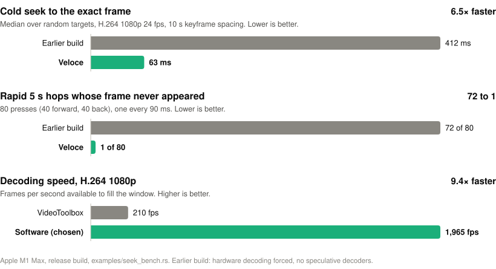
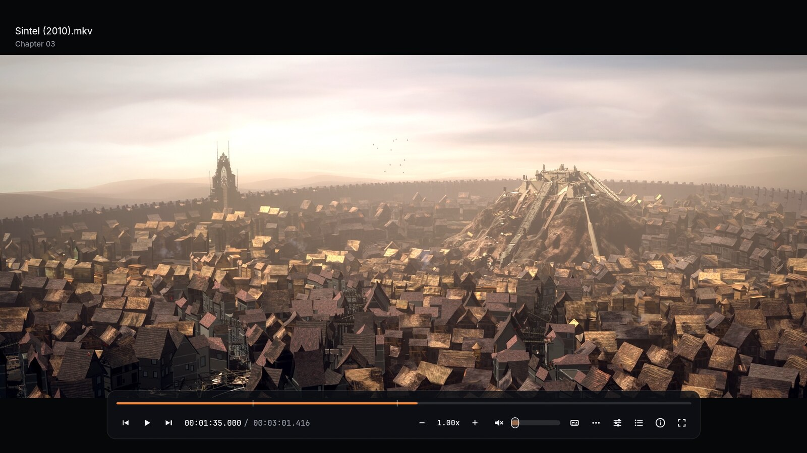
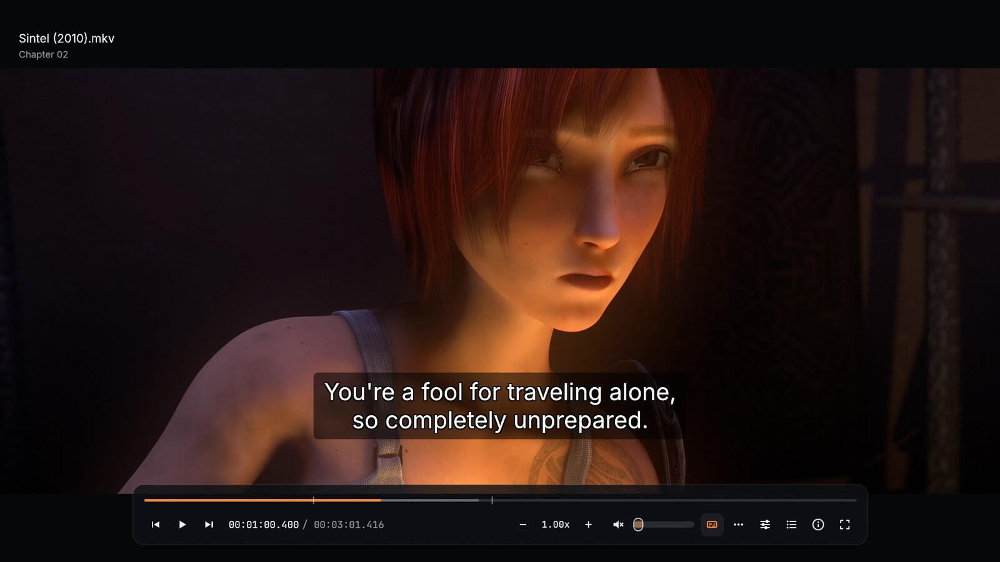
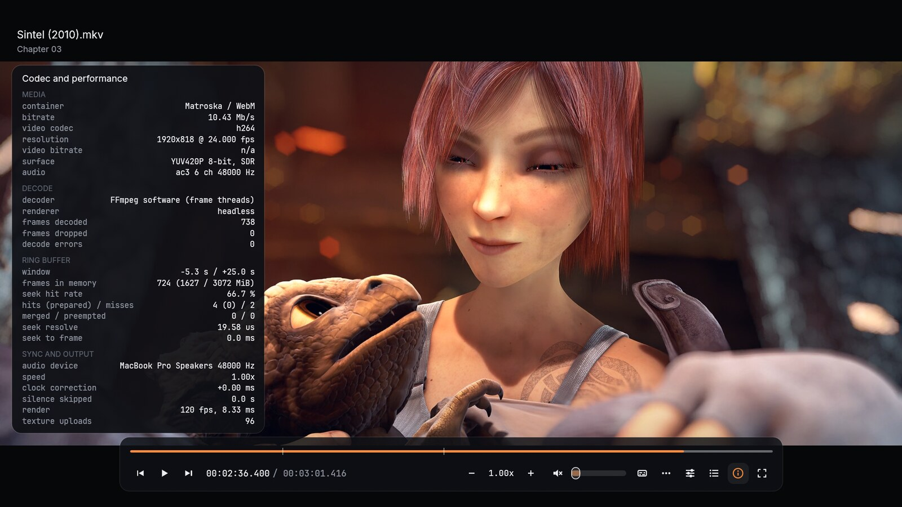
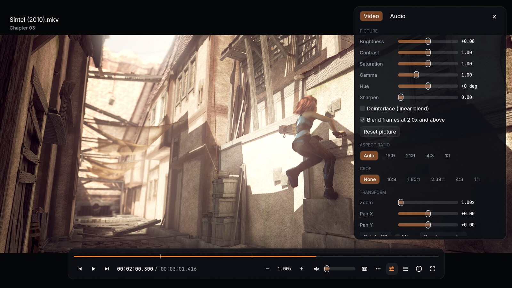
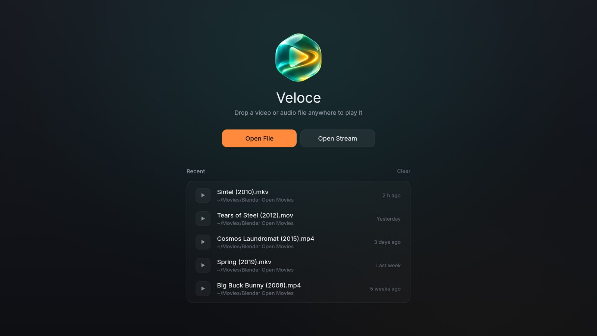
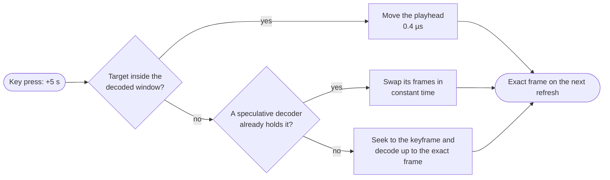
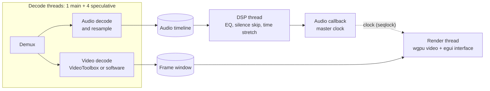

<p align="center">
  
</p>

<h1 align="center">Veloce</h1>

<p align="center">
  <strong>A native, GPU-accelerated media player in Rust where jumping 5 or 30 seconds lands on the exact frame, instantly.</strong>
</p>

<p align="center">
  
  
  
  
  
  <a href="LICENSE"></a>
</p>

<!--
Recording: target/readme-media/veloce-hops.mp4, made by scripts/readme-media.sh and hosted as a
GitHub attachment. To show it, move the two blocks below out of this comment and replace
VIDEO_LINK_GOES_HERE with the https://github.com/user-attachments/assets/... link, alone on its line.

VIDEO_LINK_GOES_HERE

<p align="center">
  <sub>Five +5 s and three −5 s presses during playback, recorded from the running app in real time. Each press shows the exact frame at the target.</sub>
</p>
-->

## Why Veloce

Most players answer a jump by asking the decoder to start over from the nearest keyframe, so repeated taps on the arrow keys stall, or show a nearby frame first and correct it later. Veloce keeps the decoded frames and audio around the playhead in memory and decodes the places you are likely to jump to before you press the key. A jump becomes a memory lookup, and the frame on screen is always the exact one.

| | |
| ---: | :--- |
| **0.4 µs** | to answer a jump that lands inside the decoded window |
| **40 of 40** | rapid `+5 s` presses whose exact frame was already decoded when the key went down (1080p, one press every 90 ms) |
| **63 ms** | median jump to a random point of a 1080p H.264 clip with 10 s keyframe spacing, down from 412 ms |
| **9.4×** | faster decoding of 1080p H.264, by choosing the decoder per file instead of always using the hardware one |
| **0** | approximate or keyframe-only frames ever shown, by design |

## Benchmarks

<picture>
  <source media="(prefers-color-scheme: dark)" srcset="docs/media/benchmarks-dark.svg">
  
</picture>

The benchmark is a headless driver for the same engine the player uses, and it fails if any jump shows a frame other than the one at the target. Full tables for four kinds of content, the method and the commands to reproduce them are in [docs/performance.md](docs/performance.md).

## Screenshots

<table>
  <tr>
    <td width="50%"><br><sub><b>Playback.</b> A translucent control capsule that fades away while you watch.</sub></td>
    <td width="50%"><br><sub><b>Subtitles.</b> SRT, WebVTT and ASS, embedded or external. The track choice follows you to the next file.</sub></td>
  </tr>
  <tr>
    <td width="50%"><br><sub><b>Inspector.</b> Live codec, decoder, buffer and sync counters, including how many jumps were prepared in advance.</sub></td>
    <td width="50%"><br><sub><b>Picture and audio.</b> Grading, crop, zoom, rotation, a 10-band equalizer and a silence skipper.</sub></td>
  </tr>
  <tr>
    <td colspan="2"><br><sub><b>Welcome screen.</b> Recently played files, newest first. Files that no longer exist are hidden.</sub></td>
  </tr>
</table>

## Features

- **Exact, instant jumps.** `±5 s` and `±30 s` from the keyboard, frame stepping, and a scrubber with chapter marks. Bursts of jumps cancel each other, so only the last one is decoded.
- **Speed without chipmunks.** `0.25×` to `4.0×` with the pitch preserved, plus a silence skipper that speeds through quiet passages in lectures and podcasts.
- **Picture.** Hardware or threaded software decoding, 8 and 10-bit video straight to the GPU, BT.601/709/2020, HDR10 and HLG tone mapping, grading, sharpening, deinterlacing, aspect, crop, zoom, pan, rotation and mirroring.
- **Sound.** Multiple audio tracks, a 10-band equalizer with presets, volume up to 200 % and audio delay in 25 ms steps.
- **Subtitles.** Embedded and external tracks, sidecar files such as `Movie.fr.srt` picked up automatically, delay in 50 ms steps, adjustable size, position and backdrop.
- **Everyday tools.** A-B loop, lossless PNG snapshots, playlist with shuffle and repeat, network streams (HTTP, HLS, RTSP), drag and drop, and VLC-style keyboard shortcuts.
- **A real Mac app.** Opens from Finder and the Dock, appears in **Open With**, and has a native icon in every appearance of macOS 26 and later.

## How it works



1. **A window of decoded frames.** Up to ten seconds behind and twenty-five ahead of the playhead stay in memory, with the matching audio. A jump inside it is a binary search.
2. **Speculative decoders.** Four extra decoders wake up after a jump and prepare the exact frames where the next presses are likely to land: after a `+5 s` jump, at `+5`, `+10`, `+15` and `-5` seconds from there. When a jump lands on one, its frames are swapped into the window and it becomes the main decoder.
3. **Audio is the clock.** The audio callback publishes the playback position through a lock-free seqlock, and the render thread picks the frame for that time on every display refresh.



The full design, including memory budgets, the seek protocol and the decoder selection rule, is in [docs/architecture.md](docs/architecture.md).

## Engineering highlights

- **About 11,800 lines of Rust in 87 modules**, none longer than 250 lines, with no `unwrap()` outside tests.
- **100 headless tests**: offscreen GPU rendering including HDR10 tone mapping, an FFmpeg decode and seek round trip, the player end to end, pitch preservation across speeds, A/V marker alignment, and a layout pass over every interface surface.
- **Correctness enforced by the benchmark.** It fails on any frame that is not the exact target, and on any gap in the decoded window.
- **Concurrency without stalls.** Every seek takes a fresh epoch and is decided atomically, so frames and audio from an abandoned seek are recognized and dropped. Audio reaches the output callback through a lock-free single-producer ring, and the clock reaches the render thread through a seqlock.
- **Measured, not assumed.** Profiling showed VideoToolbox about nine times slower than FFmpeg's frame-threaded decoder for 1080p H.264 on an M1 Max, so the decoder is chosen per file.
- **A custom WGSL shader.** Bit-depth-aware YUV conversion, PQ and HLG linearization, BT.2020 to BT.709 gamut mapping, ACES filmic tone mapping and grading in one pass.
- **Reproducible visuals.** The screenshots and the recording above are rendered by a test that drives the real player offscreen ([scripts/readme-media.sh](scripts/readme-media.sh)).

| Area | Built with |
| --- | --- |
| Demux and decode | FFmpeg 7 via `ffmpeg-next`; VideoToolbox, D3D11VA, NVDEC and VAAPI |
| Rendering | `wgpu` 30 and WGSL |
| Interface | `egui` 0.37 and `winit` 0.30 |
| Audio | `cpal`, Signalsmith Stretch and a custom biquad equalizer |
| macOS | `objc2` for Apple Events; Icon Composer and `actool` for the icon |

## Getting started

### macOS app

```sh
brew install ffmpeg pkg-config
scripts/macos/bundle.sh --install
```

Veloce is then in `/Applications`, Launchpad and Spotlight, and in Finder's **Open With** menu for video and audio files. To make it the default player for a format, select a file in Finder, choose **File > Get Info**, pick Veloce under **Open with** and click **Change All**. The bundle links Homebrew's FFmpeg and is signed ad hoc, so it runs on the machine that built it.

### From source

Requirements: Rust 1.88 or newer, the FFmpeg development libraries with `pkg-config`, and a C++ toolchain with libclang for the time-stretching library.

```sh
# Debian / Ubuntu
sudo apt install libavcodec-dev libavformat-dev libavutil-dev libavdevice-dev \
  libavfilter-dev libswscale-dev libswresample-dev pkg-config clang libasound2-dev
```

```sh
cargo run --release                       # welcome screen
cargo run --release -- movie.mkv          # one or more files or URLs
cargo run --release -- https://example.com/live/index.m3u8
cargo test                                # headless test suite
```

<details>
<summary><b>Command-line options and environment</b></summary>

| Option | Effect |
| --- | --- |
| `--mute` | Start with audio muted |
| `--paused` | Open media without starting playback |
| `--inspector` | Show the codec and performance inspector on launch |
| `--cache-mb <N>` | Memory budget of the frame window in MiB (default 3072) |
| `--demo` | Play the built-in procedural 4K 60 fps stream used for benchmarks |

`VELOCE_CACHE_MB` sets the same budget from the environment. `VELOCE_HWACCEL` selects the video decoder: unset picks automatically, `on` forces hardware decoding and `off` forces software decoding.

</details>

<details>
<summary><b>Keyboard shortcuts</b></summary>

| Key | Action |
| --- | --- |
| `Space` | Play / pause |
| `Left` / `Right` | Jump 5 s back / forward |
| `Shift` + `Left` / `Right` | Jump 30 s back / forward |
| `,` / `.` | Previous / next frame |
| `[` / `]` | Slower / faster (0.25× to 4.0×) |
| `=` | Reset speed to 1.0× |
| `Up` / `Down` | Volume up / down (to 200 %) |
| `M` | Mute |
| `F` | Fullscreen (also double-click) |
| `S` | Cycle subtitle tracks |
| `B` | Cycle audio tracks |
| `J` / `K` | Audio delay -25 ms / +25 ms |
| `G` / `H` | Subtitle delay -50 ms / +50 ms |
| `L` | A-B loop: set A, set B, clear |
| `N` / `P` | Next / previous playlist item |
| `Shift` + `N` / `P` | Next / previous chapter |
| `E` | Filters and equalizer |
| `Cmd/Ctrl` + `I` | Codec and performance inspector |
| `Cmd/Ctrl` + `L` | Playlist drawer |
| `Cmd/Ctrl` + `O` | Open file |
| `Cmd/Ctrl` + `U` | Open network stream |
| `Cmd/Ctrl` + `S` | Save a PNG snapshot of the current frame to `~/Pictures/Veloce` |
| `Esc` | Close the open drawer, or leave fullscreen |

</details>

## Status and limitations

Veloce is developed and measured on macOS with Apple silicon. The Windows and Linux hardware decoding paths compile but have not been exercised. Bitmap subtitles (PGS, VobSub) are not rendered yet, and ASS styling is reduced to plain text. The complete list is in [docs/architecture.md](docs/architecture.md#limitations).

## License and credits

Veloce is released under the [MIT License](LICENSE).

The screenshots and the recording show [Sintel](https://durian.blender.org/) (2010), © Blender Foundation, licensed under [CC BY 3.0](https://creativecommons.org/licenses/by/3.0/). The bundled typefaces, Inter and JetBrains Mono, are licensed under the SIL Open Font License 1.1; their license texts are in `assets/fonts`.
